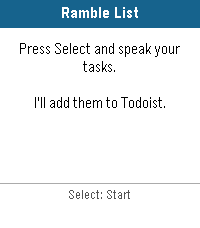

# Todoist Ramble

A Pebble watchapp that lets you dictate tasks by voice and adds them to [Todoist](https://todoist.com) — hands-free, from your wrist.



## What it does

Press Select, speak your tasks naturally, and Todoist Ramble figures out where one task ends and the next begins. Say something like:

> "Pick up groceries, call the dentist, and finish the quarterly report"

and three separate tasks will be added to your Todoist inbox (or a project of your choice).

By default, after dictation the watch shows a scrollable preview of the parsed tasks so you can confirm they look right before anything is sent. Press Select to add them, or Back to cancel.

## Configuration

Settings are managed through the Pebble app on your phone (tap the gear icon next to Todoist Ramble).

| Setting | Required | Description |
|---|---|---|
| **API Token** | Yes | Your Todoist API token. Find it in Todoist under **Settings → Integrations → Developer**. Without this the app cannot add tasks. |
| **Project ID** | No | The numeric ID of the Todoist project to add tasks to. Leave blank to send tasks to your Inbox. You can find a project's ID in its URL when viewed in a browser. |
| **Quick Launch** | No | Skip the idle screen and start listening immediately when the app opens. Useful if you launch the app specifically to dictate. |
| **Skip task preview** | No | Add tasks immediately after dictation without showing the confirmation screen. Useful if you trust the transcription and want the fastest possible flow. |
| **Keyword rules** | No | Spoken keywords to swap for a section, label, or other text. See [Keyword shortcuts](#keyword-shortcuts). |

## How tasks are parsed

Todoist Ramble splits your speech into individual tasks on natural spoken boundaries: the words *and*, *also*, *then*, *next*, commas, periods, and numbered lists. Keyword rules are then applied to each task, after which each resulting fragment is capitalized and leading filler words are stripped. Short fragments and pure stop-words are discarded.

## Keyword shortcuts

Todoist's `/Section` and `@label` syntax is hard to say out loud, so you can map spoken keywords to it instead. Enter the rules as JSON under **Keyword Shortcuts** in the settings:

```json
[
  { "keywords": ["costco", "bulk"], "replace": "/Costco" },
  { "keywords": ["lowes", "at lowes", "from lowes"], "replace": "/Lowes" },
  { "keywords": ["today", "tomorrow", "urgent"], "replace": "@Urgent" }
]
```

With these rules, saying *"coffee creamer costco and clear bins from Lowes, then call mom tomorrow"* creates:

| Task | Section | Label |
|---|---|---|
| Coffee creamer | Costco | |
| Clear bins | Lowes | |
| Call mom | | Urgent |

How the rules work:

- **Matching.** Keywords match whole words or phrases, ignoring case, and apply to the task they're spoken in. When keywords overlap, the longest one wins, so `"at lowes"` takes the *at* along with it while `"lowes"` alone leaves it behind ("Clear bins at").
- **`/Name`** puts the task in that section of your project. Names can contain spaces (`"/Home Depot"`), and case doesn't matter when matching your sections. With no Project ID set, sections from any project are searched and the task moves to that section's project. If no section matches, the task is still added with `/Name` left in its title so it's easy to spot.
- **`@Name`** adds that label. One replacement can set a section and labels together, like `"/Costco @Bulk"`.
- **Anything else** is plain find-and-replace text in the task title. An empty `"replace": ""` deletes the keyword, which is handy for filler words.
- **Preview.** The confirmation screen shows the result in Todoist syntax ("Coffee creamer /Costco") before anything is sent.
- **Validation.** The settings page checks the rules as you type and lists how each one will be applied. Trailing commas and curly quotes are accepted.

Because *and*, *also*, *then*, and *next* split tasks apart, a keyword containing one of those words (like "Barnes and Noble") will never match. Use a shorter keyword such as "barnes" instead.

## Installation

> **This app is not currently published to any Pebble app store.** To install it you need to sideload the `.pbw` file directly.

**Prerequisites:** [Rebble](https://rebble.io) account and the Pebble app configured to use the Rebble services (required for dictation).

**Steps:**

1. Clone this repo and install the [Pebble SDK](https://developer.rebble.io/developer.pebble.com/sdk/index.html).
2. From the `todoist-ramble/` directory, run:
   ```
   pebble build
   pebble install --cloudpebble
   ```
   or transfer `build/todoist-ramble.pbw` to your phone and open it with the Pebble app.
3. Open the Pebble app, go to **My Pebble → Todoist Ramble → Settings**, and enter your Todoist API token.

## Supported hardware

Built and tested on **Pebble Time 2 (Emery)**. The app targets all SDK 3 color platforms: Basalt (Pebble Time), Chalk (Pebble Time Round), and Emery (Pebble Time 2).
